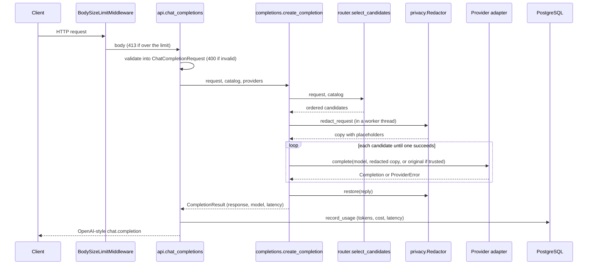

# Architecture

## Components

| Module | Responsibility |
|---|---|
| `main.py` | `create_app()` builds the FastAPI app. Its lifespan creates the database engine, the enabled providers (`start_providers()`), the personal data detector (`start_detector()`) and the filtered model catalog, and closes them on shutdown. Also holds the body size limit middleware. |
| `api.py` | HTTP routes. They validate input, call the domain code and return responses; no business logic. |
| `schemas.py` | Pydantic models for request and response bodies, shaped like the OpenAI API. |
| `errors.py` | `APIError` and the handlers that turn every failure into `{"error": {message, type, code}}`. |
| `config.py` | `Settings` (environment variables) and `ModelInfo` + `load_catalog()` (the TOML price table). |
| `router.py` | Pure functions: score a request's complexity, map score to tier, filter and rank models. |
| `completions.py` | `create_completion()`: asks the router for candidates, redacts personal data for untrusted providers, tries candidates in order with fallback, and restores the reply. |
| `providers/` | `Provider` protocol, shared failure handling, and one adapter per backend (`mock.py`, `ollama.py`, `openai.py`, `anthropic.py`). |
| `privacy/` | `Detector` protocol, `Redactor` (placeholders and restore, per request) and `PrivacyPolicy`; detectors in `regex.py` (built in) and `presidio.py` (optional extra). |
| `usage.py` | `usage_records` table, `record_usage()` and `usage_summary()`. |
| `db.py` | Shared SQLAlchemy declarative base. |
| `migrations/` | Alembic migrations; the source of truth for the schema. |

Dependencies point one way: `api` → `completions` → `router`/`privacy` →
`config`/`providers`/`schemas`. The router and the detectors do no I/O, so they are tested
with plain function calls.

## Request flow: `POST /v1/chat/completions`

1. **Size limit.** `BodySizeLimitMiddleware` counts body bytes as they stream in and raises
   413 past `MAX_REQUEST_BYTES`. It counts rather than trusting `Content-Length` because
   chunked requests don't send that header.
2. **Validation.** FastAPI parses the JSON into `ChatCompletionRequest`. Errors become a 400
   that names the field and the reason but never echoes the submitted value.
3. **Routing.** `select_candidates()` returns the explicitly requested model, or for `auto`:
   `score_complexity()` → `required_tier()`, hard filters (capabilities, context window),
   then strong-enough models cheapest-first followed by weaker models strongest-first.
4. **Redaction.** `create_completion()` builds one `Redactor` for the request and runs the
   detector over every message in a worker thread (detection is CPU work). Each value
   becomes a placeholder such as `<EMAIL_1>`, the same one wherever it appears.
5. **Fallback.** It calls each candidate's provider, sending the redacted copy unless the
   provider is listed in `PII_TRUSTED_PROVIDERS`. A `ProviderError` (timeout, connection
   refused, HTTP error, malformed reply) marks that provider as failed for the rest of the
   request and moves on. If none succeed: 502.
6. **Restore.** Placeholders in the reply are swapped back for the original values, in one
   pass. The number of values replaced goes into the `X-PII-Redactions` response header.
7. **Ledger.** `record_usage()` computes cost from the provider-reported token counts and the
   model's prices, and inserts one `usage_records` row.
8. **Response.** OpenAI `chat.completion` shape with real token usage.

## Data model

`usage_records`: one row per completed request.

| Column | Type | Notes |
|---|---|---|
| `id` | `bigint` | Primary key |
| `created_at` | `timestamptz` | Set by the database |
| `model`, `provider` | `varchar` | What actually served the request (after fallback) |
| `prompt_tokens`, `completion_tokens` | `integer` | As reported by the provider |
| `cost_usd` | `numeric(12, 8)` | Exact; never a float |
| `latency_ms` | `integer` | Provider call time only |

## Provider adapters

Each adapter translates the OpenAI-style request into its provider's format and back, and
turns every failure into `ProviderError` via `provider_error()`, which names the HTTP status
or exception type but never the response body.

| Adapter | Translation |
|---|---|
| `ollama.py` | `/api/chat`; `max_tokens` → `options.num_predict`, JSON mode → `format: "json"` |
| `openai.py` | `/chat/completions`; `max_tokens` → `max_completion_tokens` (reasoning models reject the old name) |
| `anthropic.py` | `/v1/messages`; system messages → top-level `system`, `max_tokens` always sent (required), text blocks only, `stop_reason` → OpenAI `finish_reason`; JSON mode becomes an instruction, since Anthropic has no schema-less JSON mode |

The cloud adapters don't forward `temperature`, because current reasoning models reject
non-default sampling parameters. Cloud providers switch on only when their API key is set;
keys are held as `SecretStr` so they never appear in a repr or traceback.

## Privacy by default

Personal data is replaced before provider calls (above). Prompt and response content is
never logged, and neither are placeholder mappings. Provider errors carry the HTTP status or
exception type only, because an upstream error body can echo the prompt. Validation errors
don't echo input.

Detectors implement one method, `find(text) -> list[Span]`. The built-in regex detector
validates IBANs (mod-97) and card numbers (Luhn) to cut false positives, and every pattern
runs in linear time so a large hostile body can't stall the event loop. The Presidio
detector adds NLP-based name detection.

## Not built yet

Authentication, rate limiting, budgets, MCP, metrics and streaming responses arrive in
later phases (see the README roadmap).
