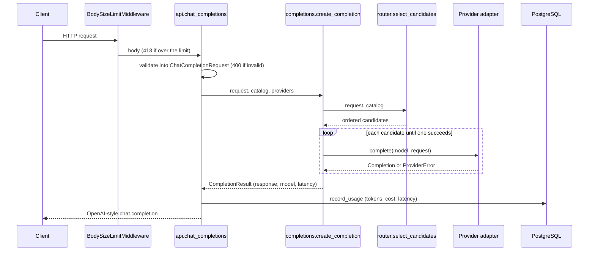

# Architecture

## Components

| Module | Responsibility |
|---|---|
| `main.py` | `create_app()` builds the FastAPI app. Its lifespan creates the database engine, the enabled providers and the filtered model catalog, and closes them on shutdown. Also holds the body size limit middleware. |
| `api.py` | HTTP routes. They validate input, call the domain code and return responses; no business logic. |
| `schemas.py` | Pydantic models for request and response bodies, shaped like the OpenAI API. |
| `errors.py` | `APIError` and the handlers that turn every failure into `{"error": {message, type, code}}`. |
| `config.py` | `Settings` (environment variables) and `ModelInfo` + `load_catalog()` (the TOML price table). |
| `router.py` | Pure functions: score a request's complexity, map score to tier, filter and rank models. |
| `completions.py` | `create_completion()`: asks the router for candidates and tries them in order with fallback. |
| `providers/` | `Provider` protocol plus one adapter per backend (`mock.py`, `ollama.py`). |
| `usage.py` | `usage_records` table, `record_usage()` and `usage_summary()`. |
| `db.py` | Shared SQLAlchemy declarative base. |
| `migrations/` | Alembic migrations; the source of truth for the schema. |

Dependencies point one way: `api` → `completions` → `router` → `config`/`providers`/`schemas`.
The router does no I/O, so it is tested with plain function calls.

## Request flow: `POST /v1/chat/completions`

1. **Size limit.** `BodySizeLimitMiddleware` counts body bytes as they stream in and raises
   413 past `MAX_REQUEST_BYTES`. It counts rather than trusting `Content-Length` because
   chunked requests don't send that header.
2. **Validation.** FastAPI parses the JSON into `ChatCompletionRequest`. Errors become a 400
   that names the field and the reason but never echoes the submitted value.
3. **Routing.** `select_candidates()` returns the explicitly requested model, or for `auto`:
   `score_complexity()` → `required_tier()`, hard filters (capabilities, context window),
   then strong-enough models cheapest-first followed by weaker models strongest-first.
4. **Fallback.** `create_completion()` calls each candidate's provider. A `ProviderError`
   (timeout, connection refused, HTTP error, malformed reply) marks that provider as failed
   for the rest of the request and moves on. If none succeed: 502.
5. **Ledger.** `record_usage()` computes cost from the provider-reported token counts and the
   model's prices, and inserts one `usage_records` row.
6. **Response.** OpenAI `chat.completion` shape with real token usage.

## Data model

`usage_records`: one row per completed request.

| Column | Type | Notes |
|---|---|---|
| `id` | `bigint` | Primary key |
| `created_at` | `timestamptz` | Set by the database |
| `model`, `provider` | `varchar` | What actually served the request (after fallback) |
| `prompt_tokens`, `completion_tokens` | `integer` | As reported by the provider |
| `cost_usd` | `numeric(12, 8)` | Exact; never a float |
| `latency_ms` | `integer` | Provider call time only |

## Privacy by default

Prompt and response content is never logged. Provider errors are logged by exception type
only, because an upstream error body can echo the prompt. Validation errors don't echo input.

## Not built yet

Authentication, rate limiting, budgets, PII redaction, MCP, metrics and streaming responses
arrive in later phases (see the README roadmap).
